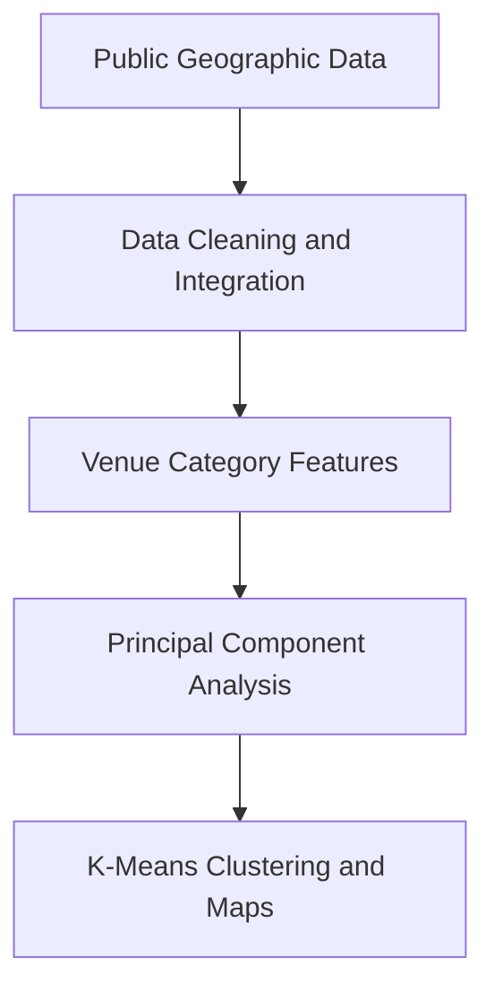

# Cross-City Neighborhood Clustering

## Toronto & New York Location Intelligence

**A data science portfolio project for comparing urban neighborhoods through venue patterns, dimensionality reduction, and unsupervised learning.**

This project examines how neighborhoods in Toronto and New York can be grouped by similar venue characteristics. It combines public geographic data, location-based venue information, principal component analysis, K-means clustering, and interactive maps to support evidence-based relocation and location-planning decisions.

**Built by Braulio · Academic Portfolio Project · Public and Third-Party Data**  
**Project Date: April 2021**

---

## Business Problem

People and businesses evaluating a move to another city often rely on broad impressions rather than structured comparisons. Neighborhoods with similar restaurants, services, entertainment, and local amenities may provide comparable living or commercial environments even when they are located in different cities.

This analysis addresses four questions:

- How can neighborhood venue data be converted into comparable features?
- Which Toronto and New York neighborhoods have similar local profiles?
- How many meaningful neighborhood groups are present in the dataset?
- How can the resulting clusters be communicated geographically?

---

## Delivered Capabilities

- Collection and preparation of Toronto and New York neighborhood data
- Wikipedia table extraction and JSON data processing
- Geographic-coordinate integration
- Location-based venue retrieval through the Foursquare API
- Venue-category transformation using one-hot encoding
- Principal component analysis for dimensionality reduction
- Cluster-count evaluation using elbow and silhouette methods
- K-means neighborhood clustering
- Interactive Folium maps for geographic interpretation
- Supporting analytical report, dataset description, and presentation

---

## Documented Analysis Results

| Analytical Measure | Reported Result |
|---|---:|
| Cities Compared | 2 |
| Shared Venue Features Before Reduction | 250 |
| Components Retained After PCA | 150 |
| Selected Neighborhood Clusters | 5 |

The project report identifies five clusters as the working segmentation and visualizes comparable neighborhood groups across both cities.

---

## Analytical Workflow



---

## Methodology

1. Prepare neighborhood names and geographic coordinates for Toronto and New York.
2. retrieve nearby venue information for each neighborhood.
3. Convert venue categories into numerical neighborhood profiles.
4. Combine the city datasets into a shared feature space.
5. Reduce dimensionality while retaining the principal variation.
6. Evaluate the cluster count and apply K-means clustering.
7. Plot the resulting neighborhood groups on interactive maps.

---

## Quick Start

### 1. Clone the Repository

```powershell
git clone https://github.com/enzosafadi/Coursera-Capstone.git
cd Coursera-Capstone
```

### 2. Create and Activate a Virtual Environment

```powershell
py -m venv .venv
.\.venv\Scripts\Activate.ps1
```

### 3. Install the Analytical Packages

```powershell
python -m pip install jupyter pandas numpy requests beautifulsoup4 lxml scikit-learn folium geopy matplotlib
```

### 4. Open the Notebooks

```powershell
jupyter notebook
```

External venue API access and updates to historical data-source URLs may be required before rerunning the complete analysis.

---

## Technology Stack

| Component | Purpose |
|---|---|
| Python | Data preparation and analytical workflow |
| Jupyter Notebook | Exploratory analysis and documentation |
| Pandas and NumPy | Data transformation and feature preparation |
| Beautiful Soup and Requests | Public web-data extraction |
| Scikit-Learn | PCA and K-means clustering |
| Folium | Interactive geographic visualization |
| Matplotlib | Analytical charts |
| Foursquare API | Historical venue-category data source |

---

## Project Structure

```text
Coursera-Capstone/
├── Capstone Project_1_IBM (1).ipynb
├── The Battle of Neighborhoods (Week 1)_Toronto.ipynb
├── The Battle of Neighborhoods_Dataset.pdf
├── Report_TheBattleOfNeighborhhods.pdf
├── The Battle Of Neighborhoods Project_Presentation.pptx
└── README.md
```

- The notebooks contain the exploratory data-processing workflow.
- The report documents the business problem, methodology, results, and conclusions.
- The presentation summarizes the project for an audience.
- The dataset document describes the geographic and venue-data inputs.

---

## Controls & Limitations

- This is a historical academic portfolio project, not a current production recommendation system.
- Results depend on the coverage and condition of the external data available when the analysis was completed.
- Venue APIs, Wikipedia structures, and geocoding services may have changed since 2021.
- Venue similarity alone does not measure affordability, safety, accessibility, demographics, or investment performance.
- The notebooks require modernization of external API configuration before reuse.
- The reported clusters demonstrate an analytical method and are not validated commercial recommendations.

---

## Production Roadmap

1. Replace historical API calls with maintained geographic and points-of-interest data sources.
2. Move credentials and configuration into secure environment variables.
3. Add housing cost, transit, safety, demographics, and economic indicators.
4. Create a reproducible data pipeline with dependency management and automated tests.
5. Publish the analysis through an interactive decision-support application.

---

## Portfolio Context

This repository demonstrates data acquisition, feature engineering, dimensionality reduction, clustering, visualization, and professional analytical communication. It is presented as an academic portfolio project rather than a live client solution.

---

**April 2021 · Academic Portfolio Project · Built by Braulio**
